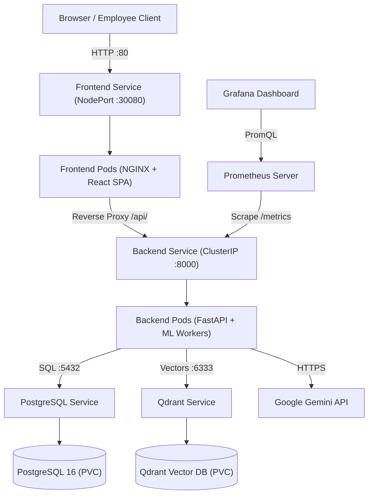

# Knowledge Base — Cloud-Native Enterprise DevOps Project

[](https://github.com/Amruthacagithub/Knowledge-Base/actions/workflows/ci.yml)
[](https://kubernetes.io/)
[](https://www.docker.com/)
[](https://fastapi.tiangolo.com/)
[](https://react.dev/)
[](https://prometheus.io/)

> **Scaler Advanced DevOps Capstone Project**  
> **Student:** Amrutha (Student ID: 23BCS10158 / Amruthaca)  
> **Baseline Commit:** [`93dcb834893ab486bdae244ea2a6a3e88a7b30ba`](docs/devops/BASELINE.md)  
> **Submission Branch:** `devops-improvements`  

---

## 1. Application Overview & Original Purpose

The **Knowledge Base** (EKIP - Enterprise Knowledge Intelligence Platform) is an AI-powered internal search assistant featuring Retrieval-Augmented Generation (RAG) with Role-Based Access Control (RBAC). It enables employees in HR, Engineering, Sales, and Administration to search company policy manuals, PDFs, and incident post-mortems to receive accurate, cited answers synthesized by Google Gemini 2.5 Flash, strictly enforcing organizational privacy boundaries.

### Core Business Features:
- **Role-Based Access Control (RBAC):** Users see and query only authorized departmental documents.
- **Hybrid Retrieval:** Dense vector search (Qdrant) + BM25 keyword search (Whoosh) with Reciprocal Rank Fusion (RRF) and Cross-Encoder neural reranking.
- **Cited AI Answers:** Grounded responses citing source document titles and exact PDF page numbers (`[1]`, `[2]`).
- **Interactive UI:** 3-pane React 19 application with ChatGPT-style conversation, collapsible source preview, text highlighting, and admin upload modal.

---

## 2. Technology Stack

| Layer | Technologies |
|---|---|
| **Frontend UI** | React 19, Vite 7, Tailwind/Custom CSS, NGINX 1.27 Alpine |
| **Backend API** | Python 3.11 / 3.13, FastAPI, Uvicorn, SQLAlchemy |
| **Datastores** | PostgreSQL 16 (metadata, audit log), Qdrant 1.16+ (vectors), Whoosh (BM25) |
| **Machine Learning** | `sentence-transformers/all-MiniLM-L6-v2`, `cross-encoder/ms-marco-MiniLM-L-6-v2`, Google Gemini 2.5 Flash |
| **Containerization** | Docker, Multi-Stage builds, Non-root (`appuser` UID 10001, NGINX unprivileged) |
| **Orchestration** | Kubernetes (Deployments, Services, ConfigMaps, Secrets, PVCs, NetworkPolicies, Kustomize) |
| **CI/CD Pipeline** | GitHub Actions (Lint, Pytest, Vitest, Trivy Vulnerability Scan, Multi-Stage Build) |
| **Observability** | Prometheus (`/metrics`), Structured JSON Access Logs (`X-Request-ID`), Grafana Dashboard |

---

## 3. Architecture Overview



For complete architectural details, see [`docs/devops/ARCHITECTURE.md`](docs/devops/ARCHITECTURE.md).

---

## 4. Prerequisites

- **Python:** 3.10+ (tested on 3.11 and 3.13)
- **Node.js:** 18+ and npm 9+
- **Docker:** Engine & CLI 24.0+
- **kubectl:** 1.28+
- **Local Kubernetes:** Minikube, kind, or Docker Desktop Kubernetes

---

## 5. Quick Start: Local Orchestration (Docker Compose)

Run the full 4-tier stack locally in seconds:

```powershell
# Using PowerShell automation:
.\run-devops.ps1 -Target up

# Or using Docker Compose:
docker compose up -d --build
```

**Access URLs:**
- **Frontend Application:** [http://localhost](http://localhost) (or [http://localhost:3000](http://localhost:3000))
- **Backend API Docs:** [http://localhost:8000/docs](http://localhost:8000/docs)
- **Health Diagnostic:** [http://localhost:8000/api/health](http://localhost:8000/api/health)
- **Prometheus Metrics:** [http://localhost:8000/metrics](http://localhost:8000/metrics)

---

## 6. Kubernetes Setup & Deployment

Deploy the entire production stack onto any Kubernetes cluster with Kustomize:

### Step 1: Render & Validate Manifests
```bash
kubectl kustomize k8s/
```

### Step 2: Deploy Stack to `knowledge-base` Namespace
```powershell
# Deploy all workloads:
kubectl apply -k k8s/

# Monitor rollout progression:
kubectl rollout status deployment/postgres -n knowledge-base
kubectl rollout status deployment/qdrant -n knowledge-base
kubectl rollout status deployment/backend -n knowledge-base
kubectl rollout status deployment/frontend -n knowledge-base
```

### Step 3: Inspect Pods & Services
```powershell
kubectl get pods,services,pvc -n knowledge-base
```

### Step 4: Access the Application
- **NodePort Access:** [http://localhost:30080](http://localhost:30080)
- **Port-Forward (Alternative):**
  ```bash
  kubectl port-forward svc/frontend-svc 8080:80 -n knowledge-base
  # Access at http://localhost:8080
  ```

---

## 7. Operational Runbook & Release Management

### Inspecting Running Version & Commit Metadata
```bash
curl -s http://localhost:8000/api/version | jq .
```
*Response:*
```json
{
  "service": "knowledge-base",
  "version": "1.0.0",
  "commit_sha": "93dcb834893ab486bdae244ea2a6a3e88a7b30ba",
  "environment": "production",
  "status": "healthy"
}
```

### Inspecting Health Probes
```bash
# Liveness probe (process responsive):
curl -s http://localhost:8000/api/health/live

# Readiness probe (datastores connected):
curl -s http://localhost:8000/api/health/ready
```

### Zero-Downtime Release & Rolling Updates
```bash
kubectl set image deployment/backend backend=kb-backend:v1.1.0 -n knowledge-base
kubectl rollout status deployment/backend -n knowledge-base
```

### Instant Release Rollback (Disaster Recovery)
If a release exhibits defects, roll back immediately:
```bash
kubectl rollout undo deployment/backend -n knowledge-base
kubectl rollout status deployment/backend -n knowledge-base
```

---

## 8. Automated Testing

```powershell
# Run backend Pytest suite (30 passed):
.\venv\Scripts\python.exe -m pytest KB-main/tests/ -m "not integration" -v

# Run frontend Vitest suite (5 passed):
cd KB-main/frontend && npm run test

# Using root automation:
.\run-devops.ps1 -Target test
```

---

## 9. DevOps Documentation Index

Complete documentation prepared for the Scaler Advanced DevOps submission:

| Document | Purpose |
|---|---|
| [`docs/devops/BASELINE.md`](docs/devops/BASELINE.md) | Baseline commit hash record, metadata, and checkout instructions |
| [`docs/devops/BASELINE_ASSESSMENT.md`](docs/devops/BASELINE_ASSESSMENT.md) | Original architecture assessment, technology stack, and gap analysis |
| [`docs/devops/REQUIREMENTS_TRACEABILITY.md`](docs/devops/REQUIREMENTS_TRACEABILITY.md) | Mapping of every rubric criterion to files and verification evidence |
| [`docs/devops/ARCHITECTURE.md`](docs/devops/ARCHITECTURE.md) | System topology, Mermaid diagrams, request paths, and network boundaries |
| [`docs/devops/DECISIONS.md`](docs/devops/DECISIONS.md) | Architectural Decision Records (ADRs) explaining design tradeoffs |
| [`docs/devops/DEPLOYMENT_RUNBOOK.md`](docs/devops/DEPLOYMENT_RUNBOOK.md) | End-to-end deployment, zero-downtime rollouts, and rollback procedures |
| [`docs/devops/OBSERVABILITY.md`](docs/devops/OBSERVABILITY.md) | Tri-partite health probes, structured logging, Prometheus metrics, and SLOs |
| [`docs/devops/SECURITY.md`](docs/devops/SECURITY.md) | Non-root containers, secret isolation, network policies, and scanning |
| [`docs/devops/TEST_RESULTS.md`](docs/devops/TEST_RESULTS.md) | Executed test logs, verification traces, and operational evidence |
| [`docs/devops/VIVA_PREPARATION.md`](docs/devops/VIVA_PREPARATION.md) | 2-minute elevator pitch, architecture walkthrough, and viva Q&A guide |
| [`docs/devops/DEMO_CHECKLIST.md`](docs/devops/DEMO_CHECKLIST.md) | Step-by-step viva presentation and live demonstration script |

---

## 10. Demo User Accounts

| User ID | Email | Department | Assigned Roles |
|---|---|---|---|
| `amrutha` | `amrutha@company.com` | HR | `Employee`, `HR` |
| `harshini` | `harshini@company.com` | Engineering | `Employee`, `Engineer` |
| `tanvi` | `tanvi@company.com` | Sales | `Employee`, `Sales` |
| `bhaskar` | `bhaskar@company.com` | Engineering | `Employee`, `Admin` (Upload access) |
| `arijith` | `arijith@company.com` | HR | `Employee` (Public docs only) |

---

## 11. Git Submission & Pull Request Details

- **Baseline Commit:** `93dcb834893ab486bdae244ea2a6a3e88a7b30ba` (preserved on `main`)
- **Submission Branch:** `devops-improvements`
- **Pull Request Target:** `devops-improvements` → `main`
- **Scope:** All DevOps improvements are delivered in a single reviewable pull request without rewriting historical commits.
