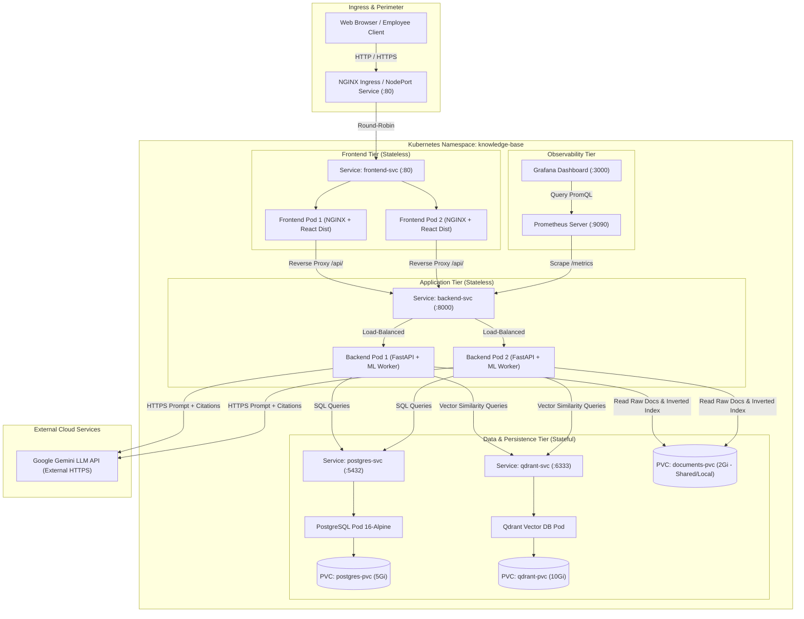
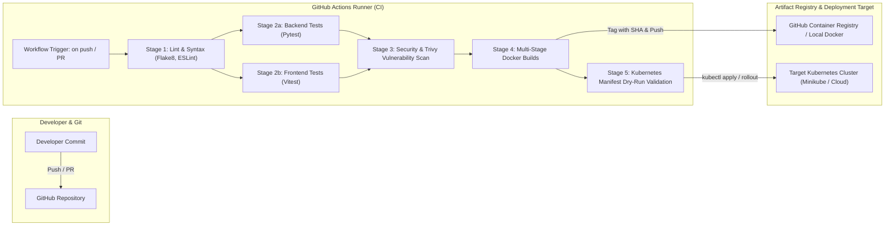

# DevOps System Architecture: Knowledge Base Platform

## 1. Architectural Vision & Operational Goals

The Knowledge Base (EKIP) is engineered as a cloud-native, multi-tier enterprise search and intelligence system. It balances high-performance machine learning inference (embeddings, vector retrieval, and LLM text generation) with strict enterprise multi-tenancy, Role-Based Access Control (RBAC), and high availability.

### Key Operational Goals:
1. **Zero-Downtime Releases:** Stateless micro-frontends and backend API pods capable of rolling upgrades (`maxSurge: 1`, `maxUnavailable: 0`) without dropping search requests.
2. **Isolation & Least Privilege:** Multi-tier network boundaries ensuring that internal databases (PostgreSQL, Qdrant) are strictly unreachable from the public internet.
3. **Resilience & Self-Healing:** Kubernetes liveness, readiness, and startup probes to automatically restart hung inference workers and route traffic exclusively to ready pods.
4. **Reproducible Local & Cloud Operation:** Identical container definitions running seamlessly in local Minikube/kind/Docker Desktop as well as production Kubernetes clusters.

---

## 2. Multi-Tier Component Topology

---

## 3. Component Responsibilities & Network Boundaries

| Component | Responsibility | Workload Type | Replicas | Network Ports | Security Context |
|---|---|---|---|---|---|
| **Frontend UI** | Serves compiled React 19 single-page application and reverse-proxies `/api/` traffic to the backend service. | Kubernetes Deployment | 2 | `80` (HTTP) | Non-root (`nginx` UID 101), read-only root filesystem with tmpfs `/tmp`, `/var/run`. |
| **Backend API** | Exposes REST endpoints, validates JWTs, evaluates RBAC rules, executes hybrid search (Qdrant + BM25), reranks results, and prompts Gemini LLM. | Kubernetes Deployment | 2 | `8000` (HTTP) | Non-root (`appuser` UID 10001), `allowPrivilegeEscalation: false`, drop all capabilities. |
| **PostgreSQL** | Persists user accounts, role mappings, document metadata, and audit logs. | Kubernetes Deployment + PVC | 1 | `5432` (TCP) | Standard Postgres non-root, isolated by Kubernetes NetworkPolicy. |
| **Qdrant Vector DB** | Stores dense vector embeddings (384 dimensions) and performs HNSW nearest neighbor searches with payload filters. | Kubernetes Deployment + PVC | 1 | `6333` (HTTP) | Standard Qdrant non-root, isolated by Kubernetes NetworkPolicy. |
| **Prometheus & Grafana** | Scrapes `/metrics` from backend pods, aggregates time-series metrics, and visualizes search latency and error rates. | Pod / External Operator | 1 | `9090`, `3000` | Standard monitoring non-root. |

---

## 4. End-to-End Request Path & Failure Boundaries

### 4.1 Search & Question-Answering Request Flow
1. **User Action:** Employee navigates to the UI, enters credentials (e.g. `harshini@company.com` [Engineer]), and submits a search query: *"What are the incident response guidelines?"*
2. **Ingress & Proxy:** NGINX frontend container receives the request. The static assets are served from `/usr/share/nginx/html`. The search request to `/api/search` is forwarded internally to `http://backend-svc:8000/api/search`.
3. **Authentication & RBAC Context:** Backend middleware intercepts the request, validates the HMAC-SHA256 JWT, checks user roles (`Engineer`), and retrieves department permissions.
4. **Hybrid Retrieval:**
   - **Vector Branch:** Calls Qdrant via `backend/services/embedder.py`. Qdrant filters results where `access_roles` contains `Engineer` OR `Employee` and returns top-20 dense candidates.
   - **Keyword Branch:** Whoosh searches inverted index in `indexdir/` and filters chunks against RBAC rules.
5. **Fusion & Neural Rerank:** Reciprocal Rank Fusion (RRF) merges candidate lists with dynamic weighting based on query classification. Cross-encoder scores and reranks the top 8 chunks.
6. **LLM Synthesis & Fallback Boundary:** Backend constructs a prompt containing the reranked chunks and queries Google Gemini API.
   - *Failure Boundary:* If Gemini API returns 503 (overloaded) or 429 (quota), backend tries configured fallback models (`gemini-2.5-flash-lite`, `gemini-3.1-flash-lite`, `gemini-2.5-flash`). If all keys fail, backend gracefully returns the top extracted document excerpts as cited fallback answers without crashing.
7. **Audit & Response:** Backend logs query details into PostgreSQL `access_audit_log` and returns JSON response with citation markers, source document IDs, and exact PDF page references.

---

## 5. Continuous Integration & Delivery (CI/CD) Architecture

### CI/CD Stage Breakdown:
1. **Source Checkout & Environment Setup:** Pins actions to verified versions and caches Python pip and Node npm dependencies.
2. **Code Quality & Static Analysis:** Runs Flake8 for backend and ESLint for frontend code formatting.
3. **Automated Test Execution:** Runs 35 backend tests with coverage and 5 frontend Vitest specs.
4. **Security Vulnerability Scanning:** Scans repository dependencies and Docker images with Trivy to block high-severity CVEs.
5. **Reproducible Container Build:** Builds both backend and frontend images using multi-stage Dockerfiles tagged with semantic version and Git commit SHA.
6. **Kubernetes Deployment Verification:** Performs `kubectl apply --dry-run=client -k k8s/` to validate schema correctness before release.

---

## 6. Important Architectural Decisions Summary

Detailed records for all decisions are maintained in [`docs/devops/DECISIONS.md`](./DECISIONS.md):
- **ADR-001:** Decoupled Micro-Frontend (NGINX) and API (FastAPI) Deployments instead of a monolithic single container.
- **ADR-002:** Standard Kubernetes Deployments with PersistentVolumeClaims over StatefulSets for PostgreSQL and Qdrant in single-instance local deployments.
- **ADR-003:** Tri-Partite Health Probing (`/live`, `/ready`, `/startup`) to protect ML cold starts.
- **ADR-004:** Non-Root Least-Privilege Execution across all container layers.
- **ADR-005:** Prometheus Pull-Based Metrics Instrumentation using Prometheus Python Client.

