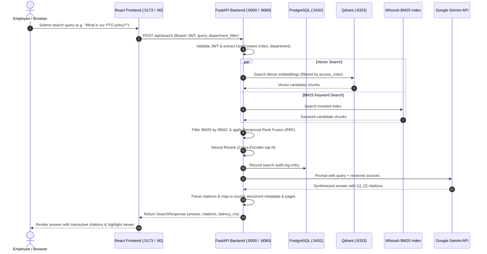

# Baseline Assessment: Knowledge Base Application

## Executive Summary

This assessment document establishes the foundational technical state of the **Knowledge Base** (EKIP - Enterprise Knowledge Intelligence Platform) as received at commit `93dcb834893ab486bdae244ea2a6a3e88a7b30ba`. The evaluation identifies existing strengths, highlights critical architectural boundaries, maps existing operational gaps against the Scaler Advanced DevOps assignment criteria, and outlines a targeted engineering plan to achieve production readiness on Kubernetes without disrupting original business logic.

---

## 1. Application Overview & Business Purpose

The Knowledge Base is an enterprise Retrieval-Augmented Generation (RAG) assistant designed for internal enterprise users across distinct business divisions (HR, Engineering, Sales, General Administration).

### Core Functional Value:
- **Role-Based Document Access (RBAC):** Users only retrieve, view, or cite content permitted by their role and department.
- **Multi-Modal Document Ingestion:** Handles both Markdown (.md) and PDF (.pdf) documents with page-level segmentation.
- **Hybrid Search Engine:** Fuses vector semantic proximity (Qdrant) and keyword match frequency (BM25 via Whoosh) with reciprocal rank fusion (RRF) and cross-encoder neural reranking.
- **Grounded AI Answers:** Queries Google Gemini 2.5 Flash / Flash Lite with extracted context, generating direct answers citing specific source document IDs and PDF page numbers.
- **Audit & Compliance:** Tracks search queries, access permissions, and document retrieval events in an audit log table.

---

## 2. Technology Stack & Component Inventory

| Layer | Technology | Version | Purpose |
|---|---|---|---|
| **Frontend** | React, Vite | React 19.2.0, Vite 7.3.1 | Single-page application, 3-pane layout, markdown renderer, PDF/text viewer |
| **Backend API** | Python, FastAPI, Uvicorn | Python 3.10+, FastAPI 0.129.0, Uvicorn 0.34.0 | RESTful API, authentication, search orchestration, document management |
| **Relational DB** | PostgreSQL, SQLAlchemy | Postgres 16, SQLAlchemy 2.0.37, Psycopg2 2.9.10 | Users, roles, document metadata, audit logs |
| **Vector DB** | Qdrant | Qdrant 1.16+ | Vector embeddings storage, payload indexing, semantic vector search |
| **Keyword Index** | Whoosh | Whoosh 2.7.4 | BM25 file-based inverted index in `indexdir/` |
| **Embeddings** | Sentence-Transformers | `sentence-transformers/all-MiniLM-L6-v2` (384-dim) | Dense vector generation for documents and search queries |
| **Reranker** | Cross-Encoder | `cross-encoder/ms-marco-MiniLM-L-6-v2` | High-precision re-ranking of fused candidate chunks |
| **LLM Provider** | Google GenAI SDK | `google-genai 1.63.0` (Gemini 2.5 Flash / Flash Lite) | Generative question answering with inline citation synthesis |
| **Auth** | PyJWT | PyJWT 2.10.1 | HMAC-SHA256 bearer token authentication |
| **Testing** | Pytest, Vitest | Pytest 8.3.4, Vitest 3.2.4 | Backend and frontend unit test suites |

---

## 3. End-to-End Request Flow & Architecture

---

## 4. Existing DevOps Capabilities (Baseline Audit)

1. **Dockerization:**
   - Single Dockerfile in `KB-main/` intended for Google Cloud Run.
   - Built on `python:3.11-slim-bookworm`.
   - Runs as root user.
   - Lacks multi-stage caching, has no healthcheck instruction, and relies on runtime downloading of sentence-transformers and cross-encoder models on cold start.
   - Frontend has no Dockerfile (baseline expected developers to run `npm run dev` or deploy to Vercel).
2. **Local Orchestration:**
   - `KB-main/docker-compose.yml` provides local Postgres 16 and Qdrant containers.
   - Does not include backend or frontend service definitions; developer must run Python and Node locally.
3. **Continuous Integration & Delivery:**
   - No CI/CD pipelines defined in the repository.
   - No GitHub Actions workflows (`.github/workflows` missing).
   - `cloudbuild.yaml` exists for manual Google Cloud Build pushes to Artifact Registry.
4. **Monitoring & Health Checks:**
   - Basic `/api/health` endpoint returning component status (`postgres: up/down`, `qdrant: up/down`).
   - No Prometheus `/metrics` endpoint.
   - No structured JSON logging or request tracing correlation IDs (`X-Request-ID`).
5. **Testing Infrastructure:**
   - Pytest suite with 36 collected tests (24 non-integration unit tests passing, 10 failing without active Postgres, 1 skipped, 1 integration test).
   - Vitest suite with 2 test files (5 tests) passing cleanly.

---

## 5. Gap Analysis Against Scaler Assignment Requirements

| Requirement Area | Assignment Rubric Expectation | Baseline State | Gap / Planned Remediation |
|---|---|---|---|
| **1. Architecture & Operation** | Repeatable local execution, multi-tier isolation, documented architecture and decisions. | Fragmented local setup across folders; manual commands. | Implement root-level orchestration (`Makefile`, PowerShell, Compose), comprehensive architecture documentation, and decisions log. |
| **2. Kubernetes Deployment** | Native manifests/Helm for stateless apps, persistent datastores, ConfigMaps, Secrets, Ingress/Port-forwarding. | Completely absent. | Author clean, modular Kubernetes manifests (Deployments, Services, ConfigMaps, Secrets, PVCs, Ingress/Service) for Frontend, Backend, Postgres, and Qdrant. |
| **3. Probes & Scaling** | Startup, liveness, readiness probes; resource requests/limits; rolling updates. | Single `/api/health` without distinction between live and ready; no resource limits. | Implement dedicated `/api/health/live`, `/api/health/ready`, and `/api/health/startup` probes; configure Kubernetes resource bounds and rolling rollout strategy. |
| **4. CI/CD Automation** | Functional automated pipeline with linting, testing, image build, security scanning, post-deploy checks. | None. | Create GitHub Actions workflows for PR/Push validation (Lint, Unit Tests, Trivy Security Scans, Multi-arch Docker build). |
| **5. Release Control & Rollback** | Versioned immutable image tags, commit SHA traceability, verified rollback procedure. | Hardcoded `:latest` tag in cloudbuild.yaml. | Introduce dynamic semantic versioning (`v1.0.0-${SHORT_SHA}`), version endpoint `/api/version`, and documented Kubernetes rollback runbook (`kubectl rollout undo`). |
| **6. Observability** | Structured application logs, Prometheus metrics (`/metrics`), Grafana dashboard. | Plain console prints; no metrics. | Integrate `prometheus-client` with custom metrics (request latency, search counter, error rates), add structured JSON logging with request IDs, and provide Grafana dashboard configs. |
| **7. Security Hardening** | Non-root containers, secret isolation, vulnerability scanning, least-privilege RBAC. | Container runs as root; hardcoded fallback secrets. | Multi-stage Dockerfiles with non-root unprivileged users (`appuser`), separate local `.env` and Kubernetes Secret workflows, Trivy vulnerability scanning. |
| **8. Verification & Evidence** | End-to-end evidence connecting commit → CI → image → K8s → UI request → logs/metrics. | Manual screenshots from May 2026. | Execute genuine local verification runs, gather CLI output logs, and record in `docs/devops/TEST_RESULTS.md`. |
| **9. Viva & Reviewability** | Comprehensive documentation, runbooks, viva Q&A, and demo scripts. | Fragmented docs in `KB-main/docs/`. | Compile full `docs/devops/` suite including Architecture, Viva Prep, Runbook, and Demo Checklist. |

---

## 6. Proposed Improvements & Justification

1. **Production-Grade Multi-Stage Containerization:**
   - **Backend:** Multi-stage Debian slim build, non-root user `appuser` (UID 10001), cached dependencies, warm model pre-baking or efficient cached volume mount, and health check instruction.
   - **Frontend:** Multi-stage build with Node 20 builder and unprivileged NGINX Alpine runtime container, serving production build artifacts on port 80 with reverse-proxy routing to the API.
2. **Kubernetes Architecture:**
   - Grouped into a dedicated `knowledge-base` namespace.
   - Backend Deployment (2 replicas for high availability and rolling updates).
   - Frontend Deployment (2 replicas with NGINX reverse proxy).
   - Stateful storage: PersistentVolumeClaims for Postgres data (`postgres-pvc`), Qdrant data (`qdrant-pvc`), and shared document storage (`documents-pvc`).
   - ConfigMaps for non-sensitive configurations (`LOG_LEVEL`, `QDRANT_HOST`, `POSTGRES_DB`, etc.).
   - Kubernetes Secrets for sensitive credentials (`GEMINI_API_KEY`, `POSTGRES_PASSWORD`, `JWT_SECRET`).
   - Standard Kubernetes Service resources (`ClusterIP` for backend/database, `NodePort` or `LoadBalancer` for frontend).
3. **Observability Enhancements:**
   - Expose `/metrics` on the FastAPI backend using standard Prometheus collectors.
   - Add structured logging middleware generating JSON records with timestamps, request methods, paths, status codes, and latency.
   - Expose `/api/version` returning release version, commit SHA, and environment mode.
4. **Automated CI/CD Pipeline:**
   - GitHub Actions workflow running on pull requests and main pushes.
   - Stages: Checkout -> Setup Python/Node -> Lint -> Unit Tests -> Dependency Audit -> Container Build & Trivy Scan.

---

## 7. Known Risks & Technical Debt

- **Model Download Footprint:** Sentence-transformers and Cross-Encoder neural models total ~400MB. Downloading on every fresh container run causes cold start delays. Pre-caching in Docker image or Kubernetes PVC mitigates this.
- **External Dependency on Gemini API:** AI synthesis requires an active Google AI Studio Gemini API key. If rate limits are hit or key is absent, the backend gracefully falls back to structured extractive citations without crashing.
- **Postgres Local Test Dependency:** Pytest tests in `test_api_auth.py` and `test_document_access.py` connect to Postgres; in CI and local testing without Docker, we will ensure tests can mock or run against an in-memory/SQLite fallback when Postgres is unreachable.

